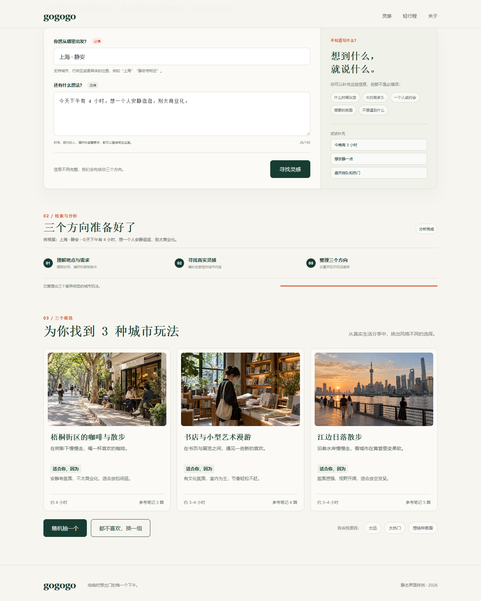

# gogogo

输入地点和当下的想法，gogogo 从小红书笔记中整理最多三个出游方向。每个方向附来源；选中后可以继续细化，或修改要求再试一次。



> 图片为界面示意，展示交互形式，不代表实时小红书搜索结果。[查看完整静态 Demo](web/demo.html)。目前没有公开运行中的在线 Demo。

## 它怎么工作

1. 根据地点和需求生成两个不同角度的搜索词。
2. 通过 Playwright 读取小红书搜索页与笔记正文，去重并筛选相关内容。
3. 用兼容 Chat Completions 的模型整理方向卡片；每张卡保留来源笔记。
4. 选中方向后只使用本次保存的笔记细化步骤。证据不足时显示缺口，不补造事实。

技术结构：浏览器前端 → Node.js HTTP 服务 → Python 工作进程 → Playwright 浏览器。Node 24 内置 SQLite 保存试用会话和运行快照。模型配置支持部署者提供 Key，或由使用者在设置页填写自己的 API。部署者的小红书登录会话由同一实例共用。

## 本地运行

需要 Node.js 24+、Python 3，以及 Windows 上的 Chrome 或 Linux 上的 Playwright Chromium。

```powershell
python -m pip install -r requirements.txt
python -m playwright install chromium
Copy-Item .env.example .env
```

在 `.env` 中设置 `TRIAL_INVITE_CODES`（服务启动必需）。若要提供站点模型，再设置 `DEEPSEEK_API_KEY`，并核对模型名与接口地址；使用者也可以在设置页填写自己的兼容 Chat Completions 的 HTTPS API。首次运行前在部署机器上扫码登录小红书：

```powershell
python xhs_connector.py login
python xhs_connector.py status
npm start
```

打开 `http://127.0.0.1:3001/`。运行 `npm test` 可执行无需账号或 API 的离线测试。Linux 部署、环境变量、接口与数据保管见[技术与部署说明](docs/technical.md)。

## Demo 与限制

- [静态界面 Demo](web/demo.html)：可直接在浏览器打开，展示输入、方向卡和细化结果；不发起搜索或模型请求。
- [开始探索页面](web/explore.html)：连接本地服务后可运行真实流程，需要部署者自行配置 API 与小红书登录。
- 仓库不包含 Cookie、API Key、数据库或历史搜索缓存。克隆后必须自行配置；GitHub Pages 不能运行本项目的 Node/Python 后端。
